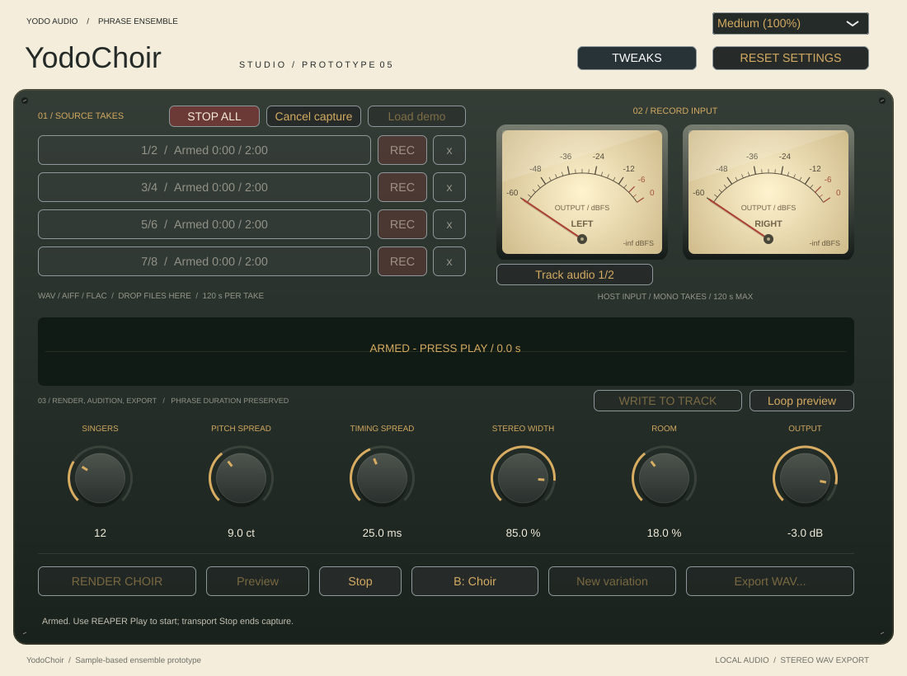
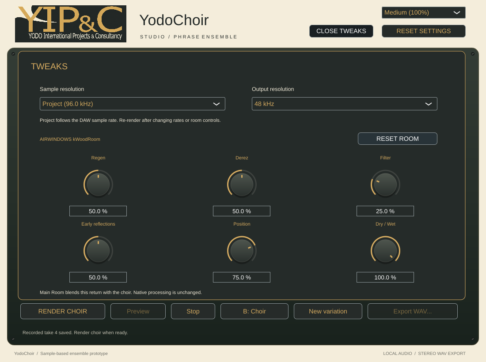

# YodoChoir — phrase ensemble and track recorder

Turn a few vocal takes into a stereo ensemble, entirely on your computer.
Import or record up to four takes of the **same phrase**, render 4–32 virtual singers,
audition the result, export a WAV, or write an aligned item directly to its Reaper track. The interface and Apple Silicon
install workflow follow [ToTape Studio](https://github.com/johandoornenbal/tape).
The header features the supplied YIP&C branding adapted to the same brass, cream
and charcoal palette.


This is an original **sample-based choir experiment**. Its first goal is to test
whether independent timing, small pitch changes and several source takes can give
useful ensemble texture. It does not train a voice model, create new singer
identities or translate lyrics. You supply the performance and words.

## Try it

1. Load one to four mono or stereo WAV, AIFF or FLAC vocal takes, or drag files
   onto empty slots. Each can be up to **two minutes (120 seconds)**, at 8–192 kHz. Stereo sources
   are summed to mono; imports follow the project sample rate by default.
2. Start with dry recordings of the same phrase, aligned at their starts. Different
   performances of the same phrase generally give more variety than one duplicated
   take. Leading silence and differences in phrasing remain in the result.
3. Choose **Singers**, **Pitch spread**, **Timing spread**, **Stereo width**,
   **Room** and **Output**, then press **Render choir**.
4. Press **Preview**. **A: Original take / B: Choir** compares the first loaded
   take with the choir at the same timeline position. It is not LUFS matching.
5. **Export WAV** saves stereo **24-bit PCM at the selected output sample rate**, including the room tail
   and rendered Output gain. Import the file into your audio track.

**Load demo** replaces the source slots with two mathematically generated “ah” vowels. They are clearly
synthetic demonstration signals, not human vocal recordings:

- [Original synthetic source](docs/audio/demo-source.wav)
- [Rendered 12-singer ensemble](docs/audio/demo-choir.wav)

**New variation** changes the deterministic seed and renders another take with
new pitch/onset offsets. **Reset settings** restores the six render controls and
seed without clearing recordings. The small `x` beside each take clears that slot;
click a loaded take to replace it. Drag/drop fills empty slots in order.

## Record four Reaper sends at once

YodoChoir now exposes **eight audio input pins** and stereo output. Set the
YodoChoir track to **8 channels** in Reaper's routing window, and use its plugin
pin connector to map track inputs 1–8 straight to plugin inputs 1–8. The VST3
input arrangement may be labelled **7.1 Cinema/SDDS** (or 7.1 Music); this is an eight-pin input
container, while YodoChoir records the consecutive pairs below as four independent
mono takes. Output remains on track channels 1/2.

| Reaper source send | YodoChoir track destination | Recorded slot |
| --- | --- | --- |
| Vocal track 1: audio 1/2 | 1/2 | Take 1 |
| Vocal track 2: audio 1/2 | 3/4 | Take 2 |
| Vocal track 3: audio 1/2 | 5/6 | Take 3 |
| Vocal track 4: audio 1/2 | 7/8 | Take 4 |

1. Insert YodoChoir as an ordinary track FX on a dedicated capture track. Route
   the four vocal sends as above. No MIDI send is required to record. Source-track
   FX, send modes and faders determine what reaches each input pair.
2. With Reaper stopped, press **ARM ALL** (or a slot's **REC**). This only arms:
   stopped callbacks and live input are not recorded. Position the playhead at the
   desired start, then press Reaper **Play**. All four slots start together on the
   first playing audio block, with identical sample counts.
3. Press Reaper **Stop**. Capture ends before any stopped audio is recorded; the
   original recording start is retained even if Reaper returns its cursor elsewhere.
   The plugin's **STOP ALL** / **Stop** also ends capture. Takes are prepared together
   in the background, and recording still stops automatically at **2:00**.
4. Press **Write to track** for the writing phase: it renders the current settings,
   saves a stereo WAV including the room tail, then adds an item on this plugin's
   own track at the saved recording start. See the writing notes below.

**Cancel capture** discards the entire recording pass, preserving all previous
takes. All four slots are replaced after a successful Record all, including slots
whose input pair was silent. Send each source to only its intended destination pair;
sending everything to 1/2 mixes those sources into Take 1.

The individual **REC** buttons use their numbered pairs for retakes: slot 1 uses
1/2, slot 2 uses 3/4, slot 3 uses 5/6, slot 4 uses 7/8. The enabled input bus is
fixed at **eight inputs**, with **two outputs**. Stereo/mono/four-/six-channel
host proposals are rejected so a host cannot silently hide three capture pairs.
An inactive input bus is still supported for imported-source preview/rendering.
Previously saved takes and controls remain compatible; route new retakes to their
numbered pair rather than relying on the former stereo-input fallback.

### If Reaper shows only two plugin input pins

Keep **Track channels: 8** and **VST3 bus size: Auto** in the pin connector.
The global bus-size menu can request eight outputs too, whereas YodoChoir has
stereo output; it is not the switch for enabling the four capture pairs.

An earlier build accepted Reaper's stereo input proposal despite initially
advertising eight inputs. The fixed build rejects that negotiation and retains
all eight input pins. Rebuild and reinstall the latest source, fully restart
Reaper, and use Preferences → Plug-ins → VST → Re-scan if its plugin information
is cached. Reinsert the FX if the existing instance still has the old layout.
The input columns should then number eight, while output has two columns.
Map track channels 1–8 straight to input pins 1–8 and choir output to 1/2.

**Track audio 1/2** lets you hear the first input pair through the YodoChoir track
while preview is stopped. Other pairs are recorded independently and are not mixed
into this monitor signal. It defaults off, useful when the source is already audible
through its own master send. If monitoring through YodoChoir, choose the source
track's routing so you hear the desired dry signal once. Choir preview replaces
the monitor signal while playing; it is not added to it.

**Cancel capture** discards the recording and preserves the previous take in the
slot. Starting a capture does not erase any previous take. Stopping without receiving any
samples also preserves it. Finishing source preparation disables recording and
source editing briefly. Rendering, auditioning and exporting wait until capture
has finished. The four per-slot REC buttons and main Stop control are not host
record-arm controls; they record only the audio actually delivered to the plugin.

Recording follows host transport and requires valid host time information and
active audio callbacks. If armed while already playing, it waits for Stop then
Play. A seek or loop jump ends the current continuous pass instead of joining
unrelated positions. Bypass, device release and sample-rate changes also finalize
partial takes. A Reaper timer fallback detects Stop if audio callbacks cease.
Other hosts without time information stay armed; they do not invent a start time.
The two-minute limit measures received samples, not wall-clock time.

### Writing an aligned item in Reaper

Save the Reaper project first, then stop transport and press **Write to track**.
The writing phase runs rendering and WAV encoding in the background. It then
prepares Reaper's waveform peaks in short steps on the main thread before creating
the item. The prepared source is transferred to the take, then the item and
arrange view are refreshed. This preserves in-memory waveform data even when
Reaper does not save peak-cache files, and avoids waiting for a project reopen
to populate the waveform. Peak preparation does not change audio samples or length.
Item creation uses Reaper's native VST3 extension API. The WAV uses
the selected output sample rate and 24-bit PCM, stored in a `YodoChoir` folder beside the project, with a unique
filename. Its item includes the complete rendered tail and uses the recorded
start, zero source offset, normal playback rate, seconds timebase and no automatic
item-edge fades. The choir's intentional singer onset offsets remain unchanged.
Alignment uses the sample position reported by the host for the first playing
block, so moving the cursor after recording does not move the print.

The destination is the track containing this instance, even if another track or
project tab is selected. Writing creates one undoable new item, preserves existing
items, and does not move the cursor or change track selection. If the owning track
or project changes during writing, placement is cancelled and the WAV is retained
for manual import. Recorded starts survive session recall. Takes recorded at
different starts must be re-recorded as an aligned pass before writing; imported
files have no capture anchor and use the owning project's edit cursor at the time
**Write to track** is pressed. Older sessions also have no stored capture anchor.

After insertion, **Track audio 1/2** is enabled so the new item passes through the
plugin. **Mute the source sends for choir-only playback**: sends and the printed
item share the track's inputs. Before another capture, mute/remove earlier printed
items too, so they do not become part of Take 1. Repeated writes add separate items;
manage or undo older prints to avoid hearing overlapping copies.

Native insertion requires a regular, non-bridged Reaper VST3 track-FX instance with
its extension API available. Other hosts can still render, preview and **Export
WAV** for manual import. This plugin does not remotely control Reaper's transport;
use the normal DAW Play and Stop buttons.




### Duration and storage

Both imported and directly recorded takes now support **120 seconds each**.
Recorded mono/stereo inputs at 8–192 kHz are summed to mono and converted to the
selected sample resolution, just like imported files. The original take is retained
if preparation fails or recording is cancelled. Buffers are allocated before
recording starts; the audio callback does not grow them or write files.

This version uses bounded memory and embedded samples rather than unlimited disk
streaming. Four full-length takes add roughly **184 MB at 96 kHz** (92 MB at 48 kHz, 369 MB at 192 kHz) of source PCM to a saved state before host encoding,
plus temporary capture/render memory. A four-pair pass reserves roughly 92 MB at
48 kHz, 184 MB at 96 kHz or 369 MB at 192 kHz before recording; capture and rendering are bounded
rather than disk-streamed. Finish recording before saving: an in-progress
capture is not included in the session until committed. Existing embedded takes
continue to be saved during capture. Truly unlimited recording would need disk-backed
capture, long-file rendering and an external-media/session-management workflow.

## Tweaks: resolution and kWoodRoom

Press **TWEAKS** to open the pane; **CLOSE TWEAKS** returns to the main interface.
Both resolution selectors default to **Project**, following the sample rate the
DAW supplies to the plugin. A 96 kHz project therefore records/imports samples,
renders the choir and exports/prints WAVs at 96 kHz. These settings control sample
rate, not bit depth: embedded samples remain float PCM and WAV output remains
24-bit PCM. Before the host supplies a rate, the fallback is 48 kHz.

| Setting | Options | Effect |
| --- | --- | --- |
| Sample resolution | Project (default), 48 kHz | Rate for new imported/recorded takes and source processing during rendering |
| Output resolution | Project (default), 48 kHz | Choir rendering, room processing, preview source, exported WAV and Write to track |

The choices are independent: keep 96 kHz samples and export at 48 kHz, or process
samples at 48 kHz while rendering at the project's 96 kHz. DAW output callbacks
always run at the host rate; preview is resampled when necessary. Changing the
project rate or either setting makes an earlier render stale: **render again**.
Rate changes preserve phrase duration, timeline placement and the six-second room
tail. Lower sample rates use sinc filtering to avoid aliasing.

Existing stored takes retain their original rate and samples when you change a
selector; the renderer converts a temporary copy. Selecting 48 kHz for samples
affects new imports/captures and lowers source processing on the next render.
Switching back cannot recover frequencies absent from a take originally stored at
48 kHz. The capture's storage rate is fixed when armed, so a host change during
capture finalizes the partial take at its previous rate. Sessions store each take's
rate, both choices and the native room parameters. Older sessions' embedded takes
are recognized as 48 kHz; missing new controls use their defaults.

The pane exposes all six native **kWoodRoom** parameters (0–100%): **Regen**,
**Derez**, **Filter**, **Early reflections**, **Position**, and **Dry / Wet**.
**RESET ROOM** restores 50%, 50%, 25%, 50%, 75%, 100%; double-clicking one dial
restores that dial. The main **Room** knob still blends the room return with the
choir outside Airwindows processing. At native Dry/Wet 100% the return is fully
wet; lowering it also puts dry audio in that return, following Airwindows' native
behavior. Render again after changing these controls. The Airwindows DSP source
is unchanged; its existing sample-rate and parameter APIs are used directly.



## DAW preview

Preview needs active DAW audio callbacks; depending on your host, enable monitoring
or start the transport. You can also import files without setting up sends.

Any **MIDI Note On** restarts the complete rendered phrase at its original pitch,
with sample-accurate event timing. MIDI triggers are ignored during capture and take preparation.
Note number/velocity do not transpose or shape
it in this prototype, and Note Off does not truncate the phrase. All Notes Off,
All Sound Off, the Stop button and host bypass stop preview. Loop preview repeats
the phrase and room tail. Host tempo, transport position and MIDI chords do not
control the render. For arranging, use Write to track in Reaper or export a WAV.

Changing render controls or sources makes the previous result stale and stops
preview at the next callback. Render again before previewing or exporting. Render
controls are saved host parameters, but **automation does not continuously
re-render audio**. Original/Choir and loop are live preview controls. Original A/B
changes preview only; export always writes the choir.

Render jobs run on a background thread and can be cancelled. Audio callbacks read
already-rendered audio without decoding files, allocating audio buffers or running
the choir renderer. Float and double host processing are supported; playback is
resampled at the host sample rate. Closing an editor does not cancel recording, playback or
rendering; destroying the plugin cancels and joins its worker.

## Controls

| Control | Range | Default | Meaning |
| --- | --- | --- | --- |
| Singers | 4–32 | 12 | Singers distributed round-robin across the loaded recordings |
| Pitch spread | 0–25 cents | 9 cents | Independent pitch offsets and gentle slow drift |
| Timing spread | 0–60 ms | 25 ms | Maximum individual onset delay |
| Stereo width | 0–100% | 85% | Singer placement; room reflections can still be stereo at 0% |
| Room | 0–50% | 18% | Airwindows kWoodRoom return; adds a six-second render tail when enabled |
| Output | −24–0 dB | −3 dB | Gain baked into the next render and export |

Pitch movement uses overlapping 50 ms Hann grains, keeping overall phrase duration
instead of changing playback speed. A small per-singer high-frequency variation
adds further differences. The Room stage uses **Airwindows kWoodRoom**, initially set to
Regen 50%, Derez 50%, Filter 25%, Early RF 50%, Position 75%, and native Dry/Wet
100%. All six native controls are available in Tweaks. YodoChoir blends that return with the choir using its main Room knob,
outside the unchanged Airwindows processing. A six-second render tail and the
existing final fade bound the offline output; this is not a claim that the native
reverb always decays completely within six seconds. Sinc interpolation handles import sample-rate conversion;
rendered preview uses linear interpolation when the output rate differs from the host rate.

The dry ensemble scales with singer count. An offline peak scan attenuates the
choir only when needed to stay below 0.94 full scale **before Output gain**; the
resulting peak trim appears below the meters. There is no compressor or automatic
loudness boost. The meters show preview output and do not affect audio. The
waveform is visually normalized to show phrase shape; it is not a calibrated meter.

The written item's length exactly matches the WAV's frame count at its output
sample rate. The renderer reserves the longest take's duration, plus **six seconds
when the main Room control is enabled**, plus the Timing spread allowance
(25 ms by default, up to 60 ms). Trailing silence in a recorded take remains part
of that take. A long item can therefore be intentional even when the final
reverberation is quiet. This waveform fix does not shorten or trim any audio.

A 20 ms end fade avoids an abrupt
render cutoff. The first loaded take supplies the Original reference, so it can
finish earlier than a choir using a longer second take. Prepare source clips to
match for a useful comparison. Preview transport and A/B are basic switches;
phrase-edge or A/B clicks on abrupt source material are possible in this prototype.

## Session recall

Sources are **embedded** as lossless float PCM at each take's stored sample rate, with the controls, seed,
A/B/loop preference and interface size. Original file paths are not required on
another machine. Rendered audio is not duplicated in the session; it is rebuilt
in the background on load. Four maximum-length takes at 96 kHz can add roughly 184 MB to a
DAW state. Save/export as usual and allow the render to finish after reopening.

Choose Small (75%), Medium (100%) or Large (125%) at the top right. All controls
scale together and the size is recalled per instance. No network service, model
download or runtime account is needed.

## Build, sign and install on your Mac

Following ToTape Studio, release support targets **Apple Silicon (M2 and later)**,
macOS 11+, VST3. Install Xcode Command Line Tools and CMake 3.22+:

```sh
xcode-select --install
brew install cmake
```

Close your DAW, clone the repository, then run:

```sh
git clone https://github.com/johandoornenbal/yodochoir.git
cd yodochoir
bash scripts/build-sign-install-mac.sh
```

This configures/builds/tests the arm64 VST3, ad-hoc signs a staged copy, verifies it,
and installs:

`~/Library/Audio/Plug-Ins/VST3/YodoChoir.vst3`

An existing installation is replaced only after signing and verification succeed.
Replacement failure preserves/restores the previous copy. No `sudo` is used.
Restart or rescan your VST3 host. Signing is ad-hoc, not notarization; Logic Pro
requires AU and cannot load this VST3 prototype. Intel/universal builds are not
part of the supported release workflow.

Install an extracted prebuilt Mac bundle with:

```sh
bash scripts/build-sign-install-mac.sh --install-only '/path/to/YodoChoir.vst3'
```

`YODOCHOIR_BUILD_DIR` and `YODOCHOIR_INSTALL_DIR` override the build/install folders.
Extra CMake arguments pass through, e.g. `-DJUCE_PATH=/absolute/path/to/JUCE`.
The default build output is `build-mac/YodoChoir_artefacts/Release/VST3/YodoChoir.vst3`.
JUCE 8.0.12 is fetched at a pinned commit unless a local checkout is provided.

GitHub Actions builds the native arm64 plugin, runs tests, signs a staged bundle,
and archives the VST3, UI previews and generated demonstration audio.

## Development and validation

Portable engine tests do not need JUCE or GUI packages:

```sh
cmake -S . -B build-dsp -DYODOCHOIR_DSP_ONLY=ON -DCMAKE_BUILD_TYPE=Release
cmake --build build-dsp --parallel 2
ctest --test-dir build-dsp --output-on-failure
```

Full development checks in the prepared Linux workspace:

```sh
source scripts/cloud-env.sh
cmake -S . -B build -DJUCE_PATH=/workspace/deps/JUCE -DCMAKE_BUILD_TYPE=Release
cmake --build build --parallel 3
ctest --test-dir build --output-on-failure
```

The eight suites (seven on non-Unix platforms) cover deterministic ensemble rendering, variation, stereo and
mono behaviour, source-rate conversion, extreme controls, headroom, cancellation,
file import and limits, MIDI event offsets, Original/Choir preview, float/double
host playback, export samples/format, embedded-source session recall, stale-render
protection, UI bindings/reset and all three sizes. Installer checks simulate
successful replacement, signature-verification failure and replacement-failure
rollback with the old copy preserved. Native Mac signing and actual DAW playback need verification on a Mac;
Linux tests do not establish those results.

In the initial November 18, 2026 Linux development run, the Release VST3 built and
all three original suites passed. The engine also passed AddressSanitizer/UndefinedBehaviorSanitizer
checks. An initial stress fixture (four 30-second sources, 32 singers) rendered in
about 0.9 seconds in this workspace with finite output and the expected length;
this is one development measurement, not a Mac performance guarantee.

For v0.2, the Linux Release VST3 and all four suites passed, including two
full 120-second recordings, large embedded-state recall and long WAV export.
Repeated recording stops were tested against a concurrently running audio callback.

For v0.3, the Linux VST3 build and all five suites passed, including four
simultaneous 120-second takes and their session recall. Channel-isolation checks
cover both the default VST3 input order and JUCE's 7.1 Music remapping. kWoodRoom
passed 96 exact upstream float/double comparisons, and the ensemble test verifies
its fully wet return and the wrapper Room blend independently.

For v0.4, the Linux Release VST3 built and all six suites passed.
Transport/native-write tests simulate Reaper's host extension and API.
They verify arm-only behavior, Play/Stop boundaries, exact saved start and recall,
seek handling, suspended-callback Stop, unsaved-project protection, destination
ownership, cursor independence, retained room tail,
undo and insertion rollback. These are API fixture tests; actual Reaper integration
and native Mac behavior still require a DAW test on a Mac.

For v0.5, the Linux Release VST3 built and all seven suites passed.
Resolution tests cover exact 96 kHz capture and preview samples, import
and WAV headers, independent 48 kHz source/output options, above-Nyquist filtering,
project-rate changes, mixed-rate session recall and old-state migration. Native
track-write fixtures now check 96 kHz WAVs and exact placement. UI checks open and
close Tweaks, exercise both selectors and all six room dials, and verify reset and
recall. An independent native kWoodRoom comparison verifies non-default parameters
and the external blend at both 48 and 96 kHz.

The input-pin fix adds a test that loads the actual compiled VST3 through its
public ABI. It verifies eight input pins and stereo output before and after
stereo, mono, quad, 5.1 and global eight-channel host proposals, followed by bus
activation at 96 kHz. This runs on Linux/macOS without pretending to be an actual
Reaper session. Reaper-on-Mac integration still needs verification in the DAW.

The waveform-write checks simulate multi-step peak generation, yielding between
slices, the existing-cache fast path, memory-only peaks, transfer of the prepared
source to the take, item refresh, source-open failure and cancellation on a changed
track. They also check decoder cleanup and unchanged item start/length. These
are Reaper API fixture tests; waveform appearance in an actual Reaper-on-Mac
session still needs verification there.

The workflow tests write actual editor previews and synthetic demo WAVs
under `build/previews`. The recording suite additionally checks stereo-pair input,
float/double capture at multiple host rates, input monitoring, fixed eight-input
layout negotiation, cancellation,
bypass/rate-change finalization, an exact 120-second auto-stop, a state larger
than 32 MB, restoration of four full-length takes, two-minute WAV export, and the
per-slot and Record all controls. Parallel checks use distinct signals on all
eight channels to verify pair isolation, aligned start/stop and cancellation.
The kWoodRoom suite checks 96 exact float/double comparisons against untouched
upstream sources with matched noise seeds; the ensemble suite independently
checks its fully wet return, external blend and six-second export tail.

## Next experiments

The most useful next step is listening to several real, aligned vocal takes and
comparing how much variation helps before words become smeared. Candidates after
that are better onset alignment, higher-quality/formant-aware pitch shifting,
per-take trim/offset controls, individual singer stems and optional harmonies.
Learned choir synthesis would require a separate model/data project.

## Licenses

Original renderer and wrapper/UI: MIT. JUCE is separately AGPLv3/commercial
licensed. See [THIRD_PARTY.md](THIRD_PARTY.md) for the ToTape reference and license
requirements. This is an independent project.
