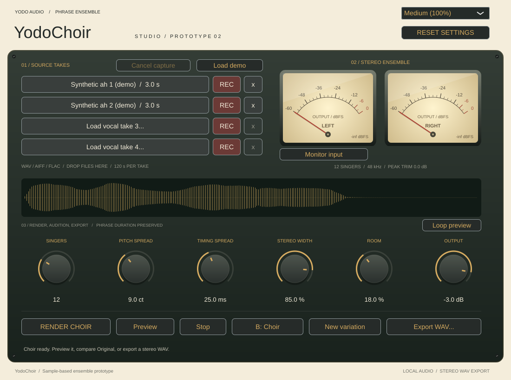
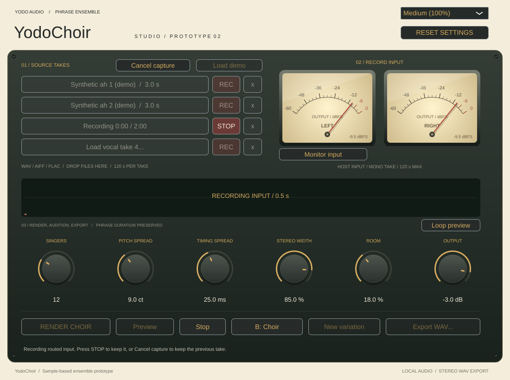

# YodoChoir — phrase ensemble and track recorder

Turn a few vocal takes into a stereo ensemble, entirely on your computer.
Import or record up to four takes of the **same phrase**, render 4–32 virtual singers,
audition the result and export a WAV to your DAW. The interface and Apple Silicon
install workflow follow [ToTape Studio](https://github.com/johandoornenbal/tape).



This is an original **sample-based choir experiment**. Its first goal is to test
whether independent timing, small pitch changes and several source takes can give
useful ensemble texture. It does not train a voice model, create new singer
identities, translate lyrics or reproduce the trained choir models of
[I AM CHOIR](https://amiaudio.io/). You supply the performance and words.

## Try it

1. Load one to four mono or stereo WAV, AIFF or FLAC vocal takes, or drag files
   onto empty slots. Each can be up to **two minutes (120 seconds)**, at 8–192 kHz. Stereo sources
   are summed to mono; imports are resampled to a canonical 48 kHz.
2. Start with dry recordings of the same phrase, aligned at their starts. Different
   performances of the same phrase generally give more variety than one duplicated
   take. Leading silence and differences in phrasing remain in the result.
3. Choose **Singers**, **Pitch spread**, **Timing spread**, **Stereo width**,
   **Room** and **Output**, then press **Render choir**.
4. Press **Preview**. **A: Original take / B: Choir** compares the first loaded
   take with the choir at the same timeline position. It is not LUFS matching.
5. **Export WAV** saves stereo **48 kHz / 24-bit PCM**, including the room tail
   and rendered Output gain. Import the file into your audio track.

**Load demo** replaces the source slots with two mathematically generated “ah” vowels. They are clearly
synthetic demonstration signals, not human vocal recordings:

- [Original synthetic source](docs/audio/demo-source.wav)
- [Rendered 12-singer ensemble](docs/audio/demo-choir.wav)

**New variation** changes the deterministic seed and renders another take with
new pitch/onset offsets. **Reset settings** restores the six render controls and
seed without clearing recordings. The small `x` beside each take clears that slot;
click a loaded take to replace it. Drag/drop fills empty slots in order.

## Recording from other tracks in Reaper

YodoChoir now has a **stereo audio input** and is listed as a VST3 audio effect
(with MIDI trigger support). Insert it as an ordinary track FX on a track called,
for example, “Choir capture”. After updating, restart/rescan Reaper if it still
shows the older input-free instrument version. The plugin identity is unchanged;
old no-input instances still work for imported samples and preview. Enable the
plugin's input bus/pins if an old instance reports that no input is available.

1. On a vocal source track, add an **audio send** to the Choir capture track.
   Route source channels **1/2 → destination channels 1/2**. No MIDI send is
   required to record audio. Use a normal post-fader send with its level/fader set
   appropriately; source-track FX and send settings determine what reaches the input.
2. Press **REC** beside the desired take slot in YodoChoir, then play the phrase
   in Reaper. The plugin records the samples arriving at its input. The two
   analogue meters show incoming level while recording.
3. Press that slot's **STOP**, or the main **Stop** button. The take is prepared
   in the background and replaces that slot only when preparation succeeds.
   Recording automatically stops and keeps the take at **2:00**.
4. For another take, route/solo the next vocal source and record another slot.
   All sends arriving on input 1/2 are mixed together by Reaper; YodoChoir captures
   that mix into one take. Record one intended performance at a time for separate
   singers, and start takes at matching positions in the phrase.
5. Press **Render choir**, then **Preview** or **Export WAV** as before.

**Monitor input** lets you hear routed audio through the YodoChoir track while
preview is stopped. It defaults off, useful when the source is already audible
through its own master send. If monitoring through YodoChoir, choose the source
track's routing so you hear the desired dry signal once. Choir preview replaces
the monitor signal while playing; it is not added to it.

**Cancel capture** discards the recording and preserves the previous take in the
slot. Starting a capture does not erase that take. Stopping without receiving any
samples also preserves it. Finishing source preparation disables recording and
source editing briefly. Rendering, auditioning and exporting wait until capture
has finished. The four per-slot REC buttons and main Stop control are not host
record-arm controls; they record only the audio actually delivered to the plugin.

Recording is independent of Reaper's transport: if the host continues processing
while stopped, silence or live input can still be captured until you press Stop.
When the host notifies the plugin of bypass, device release or a sample-rate
change, capture stops and the partial take is kept at its recorded sample rate.
If the host simply stops calling the plugin, capture waits for more samples or
your Stop press.
A two-minute limit is measured in received audio samples, not wall-clock time.
Recording requires an active host audio callback. Keep recordings in Reaper if
transport-synchronised punch-in/out is needed.



### Duration and storage

Both imported and directly recorded takes now support **120 seconds each**.
Recorded mono/stereo inputs at 8–192 kHz are summed to mono and converted to the
same canonical 48 kHz format used by imported files. The original take is retained
if preparation fails or recording is cancelled. Buffers are allocated before
recording starts; the audio callback does not grow them or write files.

This version uses bounded memory and embedded samples rather than unlimited disk
streaming. Four full-length takes add roughly **92 MB** of source PCM to a saved state before host encoding,
plus temporary capture/render memory. Finish recording before saving: an in-progress
capture is not included in the session until committed. Existing embedded takes
continue to be saved during capture. Truly unlimited recording would need disk-backed
capture, long-file rendering and an external-media/session-management workflow.

## DAW preview

Preview needs active DAW audio callbacks; depending on your host, enable monitoring
or start the transport. You can also import files without setting up sends.

Any **MIDI Note On** restarts the complete rendered phrase at its original pitch,
with sample-accurate event timing. MIDI triggers are ignored during capture and take preparation.
Note number/velocity do not transpose or shape
it in this prototype, and Note Off does not truncate the phrase. All Notes Off,
All Sound Off, the Stop button and host bypass stop preview. Loop preview repeats
the phrase and room tail. Host tempo, transport position and MIDI chords do not
control the render. For arranging, exporting the WAV is the main workflow.

Changing render controls or sources makes the previous result stale and stops
preview at the next callback. Render again before previewing or exporting. Render
controls are saved host parameters, but **automation does not continuously
re-render audio**. Original/Choir and loop are live preview controls. Original A/B
changes preview only; export always writes the choir.

Render jobs run on a background thread and can be cancelled. Audio callbacks read
already-rendered audio without decoding files, allocating audio buffers or running
the choir renderer. Float and double host processing are supported; playback is
resampled at the host sample rate. Closing an editor does not cancel recording, playback or
rendering; destroying the plugin cancels and joins its worker.

## Controls

| Control | Range | Default | Meaning |
| --- | --- | --- | --- |
| Singers | 4–32 | 12 | Singers distributed round-robin across the loaded recordings |
| Pitch spread | 0–25 cents | 9 cents | Independent pitch offsets and gentle slow drift |
| Timing spread | 0–60 ms | 25 ms | Maximum individual onset delay |
| Stereo width | 0–100% | 85% | Singer placement; room reflections can still be stereo at 0% |
| Room | 0–50% | 18% | Small stereo feedback-comb room; adds a 1.2-second tail when enabled |
| Output | −24–0 dB | −3 dB | Gain baked into the next render and export |

Pitch movement uses overlapping 50 ms Hann grains, keeping overall phrase duration
instead of changing playback speed. A small per-singer high-frequency variation
adds further differences. Sinc interpolation handles import sample-rate conversion;
rendered preview uses linear interpolation when the host is not at 48 kHz.

The dry ensemble scales with singer count. An offline peak scan attenuates the
choir only when needed to stay below 0.94 full scale **before Output gain**; the
resulting peak trim appears below the meters. There is no compressor or automatic
loudness boost. The meters show preview output and do not affect audio. The
waveform is visually normalized to show phrase shape; it is not a calibrated meter.

Room and timing can extend output duration. A 20 ms end fade avoids an abrupt
render cutoff. The first loaded take supplies the Original reference, so it can
finish earlier than a choir using a longer second take. Prepare source clips to
match for a useful comparison. Preview transport and A/B are basic switches;
phrase-edge or A/B clicks on abrupt source material are possible in this prototype.

## Session recall

Sources are **embedded** as lossless 48 kHz float PCM with the controls, seed,
A/B/loop preference and interface size. Original file paths are not required on
another machine. Rendered audio is not duplicated in the session; it is rebuilt
in the background on load. Four maximum-length takes can add roughly 92 MB to a
DAW state. Save/export as usual and allow the render to finish after reopening.

Choose Small (75%), Medium (100%) or Large (125%) at the top right. All controls
scale together and the size is recalled per instance. No network service, model
download or runtime account is needed.

## Build, sign and install on your Mac

Following ToTape Studio, release support targets **Apple Silicon (M2 and later)**,
macOS 11+, VST3. Install Xcode Command Line Tools and CMake 3.22+:

```sh
xcode-select --install
brew install cmake
```

Close your DAW, clone the repository, then run:

```sh
git clone https://github.com/johandoornenbal/yodochoir.git
cd yodochoir
bash scripts/build-sign-install-mac.sh
```

This configures/builds/tests the arm64 VST3, ad-hoc signs a staged copy, verifies it,
and installs:

`~/Library/Audio/Plug-Ins/VST3/YodoChoir.vst3`

An existing installation is replaced only after signing and verification succeed.
Replacement failure preserves/restores the previous copy. No `sudo` is used.
Restart or rescan your VST3 host. Signing is ad-hoc, not notarization; Logic Pro
requires AU and cannot load this VST3 prototype. Intel/universal builds are not
part of the supported release workflow.

Install an extracted prebuilt Mac bundle with:

```sh
bash scripts/build-sign-install-mac.sh --install-only '/path/to/YodoChoir.vst3'
```

`YODOCHOIR_BUILD_DIR` and `YODOCHOIR_INSTALL_DIR` override the build/install folders.
Extra CMake arguments pass through, e.g. `-DJUCE_PATH=/absolute/path/to/JUCE`.
The default build output is `build-mac/YodoChoir_artefacts/Release/VST3/YodoChoir.vst3`.
JUCE 8.0.12 is fetched at a pinned commit unless a local checkout is provided.

GitHub Actions builds the native arm64 plugin, runs tests, signs a staged bundle,
and archives the VST3, UI previews and generated demonstration audio.

## Development and validation

Portable engine tests do not need JUCE or GUI packages:

```sh
cmake -S . -B build-dsp -DYODOCHOIR_DSP_ONLY=ON -DCMAKE_BUILD_TYPE=Release
cmake --build build-dsp --parallel 2
ctest --test-dir build-dsp --output-on-failure
```

Full development checks in the prepared Linux workspace:

```sh
source scripts/cloud-env.sh
cmake -S . -B build -DJUCE_PATH=/workspace/deps/JUCE -DCMAKE_BUILD_TYPE=Release
cmake --build build --parallel 3
ctest --test-dir build --output-on-failure
```

The four suites cover deterministic ensemble rendering, variation, stereo and
mono behaviour, source-rate conversion, extreme controls, headroom, cancellation,
file import and limits, MIDI event offsets, Original/Choir preview, float/double
host playback, export samples/format, embedded-source session recall, stale-render
protection, UI bindings/reset and all three sizes. Installer checks simulate
successful replacement, signature-verification failure and replacement-failure
rollback with the old copy preserved. Native Mac signing and actual DAW playback need verification on a Mac;
Linux tests do not establish those results.

In the initial November 18, 2026 Linux development run, the Release VST3 built and
all three original suites passed. The engine also passed AddressSanitizer/UndefinedBehaviorSanitizer
checks. An initial stress fixture (four 30-second sources, 32 singers) rendered in
about 0.9 seconds in this workspace with finite output and the expected length;
this is one development measurement, not a Mac performance guarantee.

For v0.2, the Linux Release VST3 and all four suites passed, including two
full 120-second recordings, large embedded-state recall and long WAV export.
Repeated recording stops were tested against a concurrently running audio callback.

The workflow tests write actual editor previews and synthetic demo WAVs
under `build/previews`. The recording suite additionally checks mono/stereo input,
float/double capture at multiple host rates, input monitoring, cancellation,
bypass/rate-change finalization, an exact 120-second auto-stop, a state larger
than 32 MB, restoration of two full-length takes, two-minute WAV export, and the
per-slot recording controls.

## Next experiments

The most useful next step is listening to several real, aligned vocal takes and
comparing how much variation helps before words become smeared. Candidates after
that are better onset alignment, higher-quality/formant-aware pitch shifting,
per-take trim/offset controls, individual singer stems and optional harmonies.
Learned choir synthesis would require a separate model/data project.

## Licenses

Original renderer and wrapper/UI: MIT. JUCE is separately AGPLv3/commercial
licensed. See [THIRD_PARTY.md](THIRD_PARTY.md) for the ToTape reference and license
requirements. This is an independent project.
